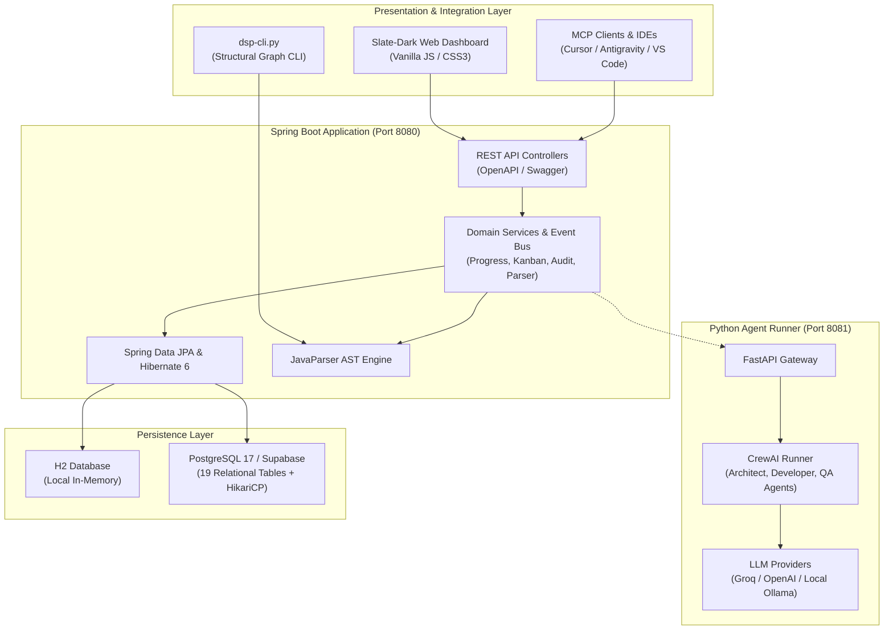

# 🧠 Developer Project Intelligence Platform (DPIP)

[](https://openjdk.org/projects/jdk/21/)
[](https://spring.io/projects/spring-boot)
[](https://www.postgresql.org/)
[](https://supabase.com/)
[](https://www.docker.com/)
[](LICENSE)

> **The unified control and command center bridging product intent, project planning, AST code intelligence, and autonomous multi-agent execution.**

---

## 📌 Overview

**DPIP** (Developer Project Intelligence Platform) is a modern software engineering control plane designed to eliminate the gap between high-level project vision and granular codebase implementations. Unlike traditional issue trackers that only track tickets or AI IDEs that only see raw code lines, DPIP constructs a **living knowledge graph** connecting:

$$\text{Project Vision} \longrightarrow \text{Epics} \longrightarrow \text{Features} \longrightarrow \text{Requirements} \longrightarrow \text{Tasks} \longleftrightarrow \text{AST Classes \& Methods}$$

With bidirectional traceability, automated progress calculation from actual codebase commits, deep JavaParser call-graph indexing, and native Python CrewAI agent integration, DPIP turns your codebase into an auditable, intelligent, and self-documenting development environment.

---

## 🌟 Key Features

### 1. 🏗️ Intent & Planning Hierarchy
* **Projects & Visions**: Enforce structured inception with immutable vision statements, lifecycle states (`Idea`, `Planning`, `In Progress`, `Completed`), and cascade constraints.
* **Epics & Features**: Break goals into manageable units with explicit priority and dependency management.
* **Feature Dependency Engine**: Built-in blocking validation prevents features from moving to `In Progress` until upstream dependencies reach `Completed`.

### 2. 📋 Requirements & Tech Architecture Decisions
* **Tech-Agnostic Requirements**: Capture business expectations cleanly before selecting tech stacks.
* **User Story Binding**: Native format (`As a [User], I want [Capability], So that [Benefit]`).
* **Technology Decision Records (ADRs)**: Evaluate competing candidate technologies, document selection rationale, tradeoffs, advantages, and architectural consequences.

### 3. 📊 Automated Progress & Task Kanban
* **Zero Manual Guesswork**: Feature, Epic, and Project progress scores are computed mathematically from requirement and task completion states—never entered manually.
* **Kanban Workflow**: Drag-and-drop workflow through `Backlog`, `Planning`, `In Progress`, `Testing`, and `Completed`.
* **Immutable Audit Trail**: Every task status transition writes an audit record with timestamp, user/agent actor, and state delta.

### 4. 🔍 AST Code Intelligence & Traceability
* **AST Parsing Engine (JavaParser)**: Scans source files to extract classes, interfaces, methods, signatures, parameters, and invocation call graphs.
* **Code Mapping Bridge**: Maps AST methods to specific requirements and tasks using `@Requirement(id="...")` and `@Task(id="...")` doc annotations.
* **Impact Analysis**: Trace what features and tasks are impacted when a core method signature or behavior changes.

### 5. 🤖 Multi-Agent Orchestration
* **CrewAI Gateway**: Dedicated FastAPI bridge (`agents/app.py` & `agents/crew_runner.py`) orchestrating autonomous agents.
* **Automated Decomposition**: Architect agents break complex requirements into executable subtask queues.
* **BDD & TDD Generators**: Generate Gherkin feature files and JUnit 5 test skeletons automatically.

### 6. 🌐 Dual-Mode Persistence & Glassmorphic Dashboard
* **Offline Local Mode**: In-memory H2 database with H2 Console for rapid offline iteration.
* **Production Cloud Mode**: Direct SSL connection to Supabase / PostgreSQL 17 with HikariCP connection pool optimization.
* **Modern Web UI**: Responsive slate-dark dashboard with real-time analytics, entity tree viewers, Kanban board, and multi-criteria search filters.

---

## 🏛️ System Architecture



---

## 🗄️ Database Schema & Entities

The platform manages **19 relational tables** enforcing strict referential integrity and audit tracking:

| Domain | Table Name | Purpose |
| :--- | :--- | :--- |
| **Project** | `public.projects` | Core projects with lifecycle status, category, difficulty, dates |
| | `public.visions` | 1-to-1 project vision statement and objectives |
| **Planning** | `public.epics` | Major functional milestones under projects |
| | `public.features` | Individual deliverables belonging to an epic |
| | `public.feature_dependencies` | Many-to-many blocking graph between features |
| **Requirements** | `public.requirements` | Tech-independent functional & non-functional requirements |
| | `public.user_stories` | Agile user stories attached to requirements |
| | `public.technologies` | Discovered or proposed technology options |
| | `public.requirement_candidates`| Candidate technologies evaluated for specific requirements |
| | `public.technology_decisions` | Selected tech stack ADRs with rationale & tradeoffs |
| **Execution** | `public.tasks` | Granular work items mapped to features |
| | `public.task_audit_logs` | Immutable audit history of task transitions |
| **Code AST** | `public.java_classes` | Indexed Java classes, interfaces, and packages |
| | `public.java_methods` | Methods, return types, parameter types, signatures |
| | `public.method_calls` | Method invocation graph (caller $\rightarrow$ callee) |
| | `public.code_mappings` | Association between tasks/requirements and code methods |
| | `public.code_candidates`| AI-suggested code modifications awaiting developer approval |
| **Agents** | `public.agent_subtask_queue` | Work units assigned to autonomous agent runners |
| | `public.agent_message` | Real-time agent thought logs and communication history |

---

## 🛠️ Tech Stack

* **Language**: Java 21 (LTS) & Python 3.11
* **Framework**: Spring Boot 3.3.x, Spring Data JPA, Hibernate 6
* **AST Analysis**: JavaParser Core 3.25+
* **Database**: PostgreSQL 17 (Supabase) / H2 In-Memory
* **Connection Pool**: HikariCP (optimized for Supabase cloud transactions)
* **API Documentation**: SpringDoc OpenAPI 2.5+ (Swagger UI)
* **Agent Framework**: CrewAI, LangChain, FastAPI, Pydantic, Uvicorn
* **Frontend**: Vanilla HTML5, Modern CSS3 (Glassmorphism & CSS Variables), JavaScript (ES6 Modules)
* **Containerization**: Docker & Docker Compose (Multi-stage builds)

---

## 📋 Prerequisites

Before running the application, ensure the following are installed:

* **Java JDK 21** or higher (`java -version`)
* **Apache Maven 3.9** or higher (`mvn -version`)
* **Python 3.10+** (optional, required if running the Python Agent service)
* **Docker & Docker Compose** (optional, for containerized execution)

---

## 🚀 Getting Started

### 1. Clone the Repository

```bash
git clone https://github.com/<your-username>/dpi-platform.git
cd dpi-platform
```

### 2. Environment Configuration

Copy the example environment file:

```bash
cp .env.example .env
```

Review `.env` to configure your preferred database and LLM keys:
* For local offline development (zero configuration needed): keep `SPRING_PROFILES_ACTIVE=local`.
* For Supabase / PostgreSQL cloud mode: set `SPRING_PROFILES_ACTIVE=prod` and provide your database credentials.

---

### 3. Running Locally

#### Mode A: Offline Quickstart (H2 In-Memory Database)
Zero configuration needed. Boots in seconds using embedded H2:

```bash
mvn spring-boot:run
```

* **Dashboard**: [http://localhost:8080](http://localhost:8080)
* **Swagger UI**: [http://localhost:8080/swagger-ui.html](http://localhost:8080/swagger-ui.html)
* **H2 Console**: [http://localhost:8080/h2-console](http://localhost:8080/h2-console) (JDBC URL: `jdbc:h2:mem:dpipdb`, User: `sa`, Password: empty)

---

#### Mode B: Production Mode (Supabase PostgreSQL)

Set environment variables in your terminal or use `.env`:

```bash
# Set your Supabase connection parameters
export SUPABASE_DB_URL="jdbc:postgresql://db.<your-project-ref>.supabase.co:5432/postgres?sslmode=require"
export SUPABASE_DB_USERNAME="postgres"
export SUPABASE_DB_PASSWORD="<your-password>"

# Start with prod profile
mvn spring-boot:run -Dspring-boot.run.profiles=prod
```

*(On Windows PowerShell, use `.\set-supabase-env.ps1` copied from `set-supabase-env.example.ps1`)*

---

#### Mode C: Docker Compose (Full Stack)

Spin up the Spring Boot backend, PostgreSQL with pgvector, and the Python Agent runner with a single command:

```bash
docker compose up -d
```

Verify services:
* **Backend Dashboard**: [http://localhost:8080](http://localhost:8080)
* **Agent Service Health**: [http://localhost:8081/health](http://localhost:8081/health)
* **PostgreSQL**: `localhost:5432`

---

## 🤖 Starting the Python Agent Runner

To enable autonomous requirement decomposition and BDD/TDD code generation:

```bash
cd agents

# Create virtual environment
python -m venv .venv

# Activate virtual environment
# Windows:
.venv\Scripts\activate
# Linux/macOS:
source .venv/bin/activate

# Install dependencies
pip install -r requirements.txt

# Start FastAPI server on port 8081
uvicorn app:app --host 0.0.0.0 --port 8081 --reload
```

---

## 🧪 Testing & Verification

Run the automated test suite including model tests, service verifications, and Cucumber feature specs:

```bash
mvn test
```

To run a specific test:

```bash
# Run Database Connection verification test
mvn test -Dtest=DatabaseConnectionTest

# Run Project Service business rule tests
mvn test -Dtest=ProjectServiceTest

# Run Kanban & Audit tests
mvn test -Dtest=TaskKanbanServiceTest
```

---

## 📚 API Reference (Highlights)

DPIP provides a rich REST API documented interactively at `/swagger-ui.html`.

### Projects & Vision
| Method | Endpoint | Description |
| :--- | :--- | :--- |
| `GET` | `/api/projects` | List all projects with aggregated progress metrics |
| `POST` | `/api/projects` | Create a new project with optional vision |
| `GET` | `/api/projects/{id}` | Retrieve comprehensive project detail graph |
| `PUT` | `/api/projects/{id}/status` | Update project lifecycle state with rule checks |

### Epics & Features
| Method | Endpoint | Description |
| :--- | :--- | :--- |
| `POST` | `/api/projects/{id}/epics` | Add an epic to a project |
| `POST` | `/api/epics/{id}/features` | Add a feature to an epic |
| `POST` | `/api/features/{id}/dependencies` | Add a dependency blocking rule |

### Tasks & Kanban
| Method | Endpoint | Description |
| :--- | :--- | :--- |
| `GET` | `/api/features/{id}/tasks` | Get tasks for a feature |
| `PUT` | `/api/tasks/{id}/status` | Move task on Kanban (triggers audit logging) |
| `GET` | `/api/tasks/{id}/audit` | Retrieve transition audit history |

### Code Intelligence & AST
| Method | Endpoint | Description |
| :--- | :--- | :--- |
| `POST` | `/api/code/scan` | Trigger JavaParser scan of a directory |
| `GET` | `/api/code/classes` | List parsed classes and interfaces |
| `GET` | `/api/code/mappings` | Query feature-to-code traceability links |

---

## 🔒 Security Best Practices

1. **No Hardcoded Secrets**: Credentials, database passwords, and API keys are strictly externalized via `.env` and environment variables.
2. **Ignored Files**: All local environments, keys, Maven target folders, and Python virtual environments are pre-configured in `.gitignore`.
3. **Container Security**: The multi-stage `Dockerfile` executes as an unprivileged non-root user (`dpip`).
4. **Row-Level Security (RLS)**: If exposing the database directly via Supabase client libraries, ensure all tables have RLS enabled with appropriate policies.

---

## 🗺️ Roadmap & Future Enhancements

- [x] Phase 1: Core Domain Entities, Lifecycle Invariants, Kanban & Progress Engine
- [x] Phase 2: AST Code Parsing (JavaParser) & Method Mapping
- [x] Phase 3: CrewAI Python Agent Integration (BDD/TDD Generation)
- [ ] Phase 4: Model Control Center & Local Ollama Routing Gateway
- [ ] Phase 5: Multi-Language AST Support via Tree-Sitter (TypeScript, Python, Go)
- [ ] Phase 6: Model Context Protocol (MCP) Server for Cursor / VS Code / Antigravity

---

## 📄 License

This project is licensed under the MIT License - see the [LICENSE](LICENSE) file for details.
