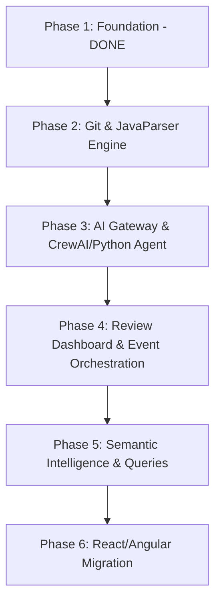

# DPIP Minimum Lovable Product (MLP) Implementation Guide

This guide outlines a simple, achievable, and structured phase-wise roadmap to transform our current Spring Boot + Supabase foundation into the complete Minimum Lovable Product (MLP) described in `MLP.txt`.

---

## Where We Are (Baseline)
We have successfully completed the foundation:
1. **Core Domain Schema**: 12 tables mapped, with UUID PKs, CHECK constraints, and indexes.
2. **Hardened Connection**: Spring Boot connects directly to Supabase with HikariCP optimizations and `ddl-auto=validate`.
3. **Traceability Enhancements**: Standardized timestamps, task-to-requirement links, requirement categorization (types/statuses), and Kanban cycle-time tracking.
4. **Interactive Dashboard**: A slate-dark single-page HTML/JS dashboard to explore projects, epics, features, and run full-text search.

---

## Phased Roadmap to the MLP

---

## Phase 2: Git & JavaParser Engine (Code Analysis)
*Goal: Teach Spring Boot to read the codebase, analyze its classes/methods, and map them to the database.*

### 1. Database Schema Additions
We need to track Java source code components. Create these tables on Supabase:
- `java_classes`: (`id` UUID, `project_id` UUID, `name` VARCHAR, `package_name` VARCHAR, `file_path` VARCHAR, `created_at`, `updated_at`)
- `java_methods`: (`id` UUID, `class_id` UUID, `name` VARCHAR, `return_type` VARCHAR, `parameters` TEXT, `signature` VARCHAR, `created_at`, `updated_at`)
- `code_mappings`: Join table linking `java_methods` (or classes) to `requirements` or `tasks`.

### 2. Spring Boot Implementation
- **Dependency**: Add `javaparser-core` to `pom.xml`.
- **Git Service**: Implement a `GitService` to clone, read, pull, and commit to a local Git directory representing the managed project.
- **Parsing Service**: Create `JavaParserService` to scan the local repository. It will parse Java files, extract classes, methods, parameters, and insert/update them in `java_classes` and `java_methods` tables.
- **Traceability Parsing**: If a Javadoc or code comment contains `@Requirement(id="req-uuid")` or `@Task(id="task-uuid")`, the parser should automatically populate the `code_mappings` table.

---

## Phase 3: AI Gateway & Execution Agent
*Goal: Set up the bridge to CrewAI (or a python agent runner) to auto-generate code based on requirements.*

### 1. Spring Boot AI Gateway
- Create a `CrewAiGatewayService` that takes a `Task` + `Requirement` context (descriptions, model details, files to modify) and serializes it to JSON.
- Expose an endpoint: `POST /api/tasks/{id}/assign-ai`. This changes the task status to `PLANNING`, logs the event, and triggers the AI runner.

### 2. CrewAI Runner (Python)
- A simple, self-contained Python script using CrewAI or a direct LangChain/OpenAI call.
- **Input**: Reads JSON context from Spring Boot.
- **Agent Roles**:
  - *Architect Agent*: Identifies which Java files need modifications or if a new class is needed.
  - *Developer Agent*: Writes/edits the Java code.
- **Output**: Returns a Git patch (diff) or file contents back to Spring Boot.

---

## Phase 4: Developer Review & Event Orchestration
*Goal: Provide a UI interface to review AI patches, accept them into Git, and update the database.*

### 1. Spring Boot Event Bus
- Implement Spring ApplicationEvents for core hooks:
  - `CodeGeneratedEvent`: Fired when CrewAI returns a code patch.
  - `CodeAcceptedEvent`: Fired when developer approves the diff.
  - `JavaParsedEvent`: Fired after JavaParser completes scanning.

### 2. Frontend Panel (Review Dashboard)
- Add a "Code Review" section to our HTML dashboard.
- Display a file diff comparison (Old Code vs New Code).
- Two actions:
  - **Approve**: Applies the patch to the local repository, runs git commit, runs `JavaParser` to update the classes/methods tables, and recalculates project progress.
  - **Reject**: Reverts the task status to `BACKLOG` and clears the temporary files.

---

## Phase 5: Semantic Intelligence & Queries
*Goal: Build the "Project Intelligence Service" that allows asking natural language questions about requirements and code.*

### 1. Schema Additions
- Add a vector extension (`pgvector`) or simple keyword/inverted index fields to Technologies, Requirements, and Java Methods.

### 2. Natural Language Query API
- Expose `GET /api/intelligence/query?q="Which classes implement user login?"`.
- The backend matches the query text against requirement descriptions, technology decisions, and method signatures/comments.
- Returns a structured mapping: *Question -> Matches Requirement -> Links to Task -> Implemented in `LoginController.java#login`*.

---

## Phase 6: Frontend Migration
*Goal: Rebuild the UI as a single-page React or Angular application once the workflow functions flawlessly.*

### Approach
- Keep the Spring Boot REST endpoints exactly the same.
- Scaffold a clean modern frontend (e.g., using Vite + React + TypeScript + Tailwind CSS).
- Implement interactive tree diagrams to visually draw the knowledge graph:
  - Visual nodes: `Project` -> `Epic` -> `Feature` -> `Requirement` -> `Task` -> `Class` -> `Method`.
  - Node color representation of status (completed, in progress, blocked).

---

## Achieving the MLP (Quick Checklist)

To quickly prove this concept with minimal effort:
- [ ] **Step 1**: Run the parser manually on a local folder when clicking a "Rescan Repository" button.
- [ ] **Step 2**: Have the AI generate code by calling a simple OpenAI API endpoint directly from Spring Boot (mocking CrewAI for simplicity) that returns a Java file.
- [ ] **Step 3**: Show the code in a textarea in our HTML frontend, allowing the developer to click "Write to File".
- [ ] **Step 4**: Save the file, run JavaParser to extract method names, and show the updated connection on the screen.
